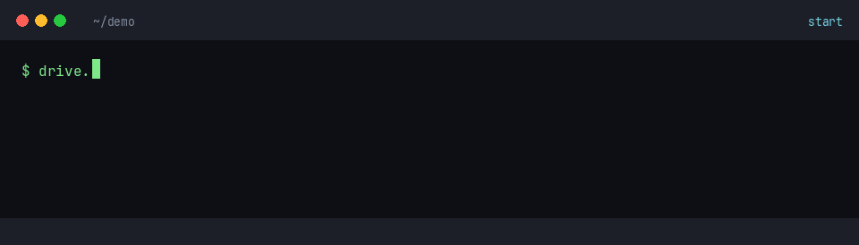

# live-qa

<h3 align="center">Live QA in a real browser, with a screenshot per step that proves what happened.</h3>

<p align="center">
  <a href="LICENSE"></a>
  
  
  
</p>

<p align="center">
  
</p>

## What it is

`live-qa` is a **procedure and a small browser driver**: it walks a flow one user-visible
step at a time, saves a numbered screenshot for each step, and ends with a pass/fail table plus the
console errors and failed requests behind every verdict. You point it at a staging URL and a list of
steps; you get evidence, not an opinion.

## The problem it removes

Agent QA usually ends in one of two useless places: a throwaway Playwright file nobody runs
again, or "looks good" in chat with nothing attached. Neither survives a code review. This produces the
thing a reviewer actually asks for: *what did you click, what did you see, and what did the console say.*

## Install

```bash
# any agent, via the skills CLI — this one, or all twelve at once
npx skills add Appit-labs/live-qa -g -y
npx skills add Appit-labs/appit-skills -g -y

# Claude Code — the whole collection as one marketplace
claude plugin marketplace add Appit-labs/appit-skills
claude plugin install live-qa@appit-skills

# pi
pi install git:github.com/Appit-labs/live-qa

# any agent that reads a skills directory
git clone git@github.com:Appit-labs/live-qa.git
cp -r live-qa/skills/live-qa ~/.claude/skills/      # or ~/.codex/skills/, .cursor/skills/, …
```

## Use

- **A full pass** — ask for live QA of a flow; it agrees the step list and expected result per step first
- **One flow, forced** — `/skill:live-qa test the checkout flow on staging`
- **Regression suite** — `references/promoting-to-a-spec.md` — only steps that went green

## Logging in, without storing a password

Four ways to get an authenticated session, best first — the reusable artifact is the
**session**, never the password (the same conclusion Playwright's own auth guide reaches):

```bash
# 1. a state file: log in once with a TEST account, reuse cookies + localStorage
LIVE_QA_USER=… LIVE_QA_PASS=… node <skill>/scripts/drive.mjs start https://stage.example.com
node <skill>/scripts/drive.mjs auth login --save .tmp/live-qa/auth/stage.json
node <skill>/scripts/drive.mjs start https://stage.example.com --storage .tmp/live-qa/auth/stage.json

# 2. a minted token: no UI login at all (the CI path)
SESSION_TOKEN=$(curl -s -X POST "$STAGE/api/test-session" | jq -r .token) \
  node <skill>/scripts/drive.mjs auth inject --cookie "session=$SESSION_TOKEN"

# 3. no credentials yet? open the login for a human, then harvest what they did
node <skill>/scripts/drive.mjs auth open https://stage.example.com/login
# … the person signs in (SSO, MFA, test account — you never hold the password) …
node <skill>/scripts/drive.mjs auth wait --save .tmp/live-qa/auth/stage.json \
     --check https://stage.example.com/dashboard --timeout 120
# add --capture-creds file.json only if they agreed: that file IS a password (0600)

# 4. always prove it — exits 0 only when actually authenticated
node <skill>/scripts/drive.mjs auth probe \
  --check https://stage.example.com/dashboard --api https://stage.example.com/api/me
```

**Google/Microsoft SSO refuses automated browsers** ("Couldn't sign you in"). The driver
already drops Playwright's `--enable-automation` flag (`navigator.webdriver === false`,
verified), and if a provider still refuses, attach to the Chrome the human already uses:

```bash
google-chrome --remote-debugging-port=9444 --user-data-dir="$HOME/.config/google-chrome"
node <skill>/scripts/drive.mjs start https://stage.example.com/login --attach 9444
# one click on "Sign in with Google" — that profile is already signed in
node <skill>/scripts/drive.mjs auth state .tmp/live-qa/auth/stage.json
```

Verified on a real app, end to end: copied Chrome profile → `--attach` → one click on
*Sign in with Google* (Google reused the session — no password typed) → app session
cookies set → `auth probe --api …` → authenticated → `auth state` (92 cookies, `0600`)
→ **fresh browser with `--storage` renders the signed-in dashboard**.

**No human needed at all** — three agent-only routes: `auth inject` (a minted session token),
`auth request` (POST the app's own JSON login inside the browser context, so `Set-Cookie` lands
there) and `auth login --totp-env` (form login + a TOTP code generated from your test secret,
verified against the RFC 6238 vectors).

**Session files are encrypted by default when a key is present**: set `LIVE_QA_STATE_KEY` and
`auth state` writes AES-256-GCM (`QAENC1`, scrypt-derived key, per-file salt); `--storage` decrypts
on load, and a wrong key fails loudly rather than silently starting a guest session. `auth info`
prints metadata only — cookie count, hosts, `savedAt`, `expiresAt` — never a value.

Rules the tool enforces: credentials only from `$LIVE_QA_USER` / `$LIVE_QA_PASS` (never
argv, never disk, never screenshotted); state files are `0600` in a `0700` `.tmp/` dir
and contain no password; `auth probe` refuses to let you confuse "page rendered" with
"signed in" — it checks for a login form, a redirect to `/login`, and the status code of
an authenticated endpoint.

## What it does not do

- It does not write a test suite for you; promotion is a deliberate, separate step.
- It does not bypass bot protection on sites you do not own, and never uses a solver.

## Requires

- **Node 18+ and Playwright** — `npm i -D playwright` (the driver ships in `scripts/drive.mjs`; real Chrome is used when installed).
- Optional: a native browser tool (pi's `agent_browser`, a Playwright/DevTools MCP server). `references/browser-lanes.md` maps the verbs.
- `ffmpeg` only for a recording.

## Cost

| | tokens |
| --- | --- |
| always-on — the description, paid every session | ~110 |
| on invoke | ~2k |

The demo above is not a mockup: `demos/live-qa.json` holds the captured run and
`tools/make_demo.py` renders it, so it can be regenerated and audited.

## Write-up

The Turnstile finding behind this skill, in article form:
[your-cloudflare-turnstile-may-never-be-issuing-a-token-here-…](https://dev.to/ibrahimbdr/your-cloudflare-turnstile-may-never-be-issuing-a-token-here-is-the-one-liner-that-tells-you-4h75)

## Provenance

Every command in this skill was run against a real target before it was written down: a live
database, a staging host, a failing CI run, a browser session. The repository was created and
published on 2026-11-18; where the workflow itself is older, `CHANGELOG.md` carries the dates.

## Security

SkillSpector: **0/100, SAFE, 0 open findings** against the committed baseline. Every accepted
finding is listed with its reason in [SECURITY.md](SECURITY.md). No `shell=True`, no credential
storage, no network destination chosen at runtime.

## Part of the Appit collection

All twelve, one install: `npx skills add Appit-labs/appit-skills -g -y`.

- [`live-qa`](https://github.com/Appit-labs/live-qa) — live QA in a real browser ← this skill
- [`ci-triage`](https://github.com/Appit-labs/ci-triage) — red CI to the failing line
- [`pg-inspect`](https://github.com/Appit-labs/pg-inspect) — read-only Postgres inspection
- [`repo-runbook`](https://github.com/Appit-labs/repo-runbook) — the verified runbook in AGENTS.md
- [`remote-exec`](https://github.com/Appit-labs/remote-exec) — SSH that cannot hang
- [`trello-tickets`](https://github.com/Appit-labs/trello-tickets) — seven ticket types, one card
- [`cloud-browser`](https://github.com/Appit-labs/cloud-browser) — hosted browsers that stop billing
- [`open-design`](https://github.com/Appit-labs/open-design) — the OpenDesign monorepo
- [`blender-pipeline`](https://github.com/Appit-labs/blender-pipeline) — Blender via MCP
- [`code-scan`](https://github.com/Appit-labs/code-scan) — Skylos + Fallow, one gate
- [`release`](https://github.com/Appit-labs/release) — conventional commits to a tag
- [`hermes-setup`](https://github.com/Appit-labs/hermes-setup) — least-privilege agent wiring


## License

MIT, copyright Appit Labs. See [LICENSE](LICENSE).
